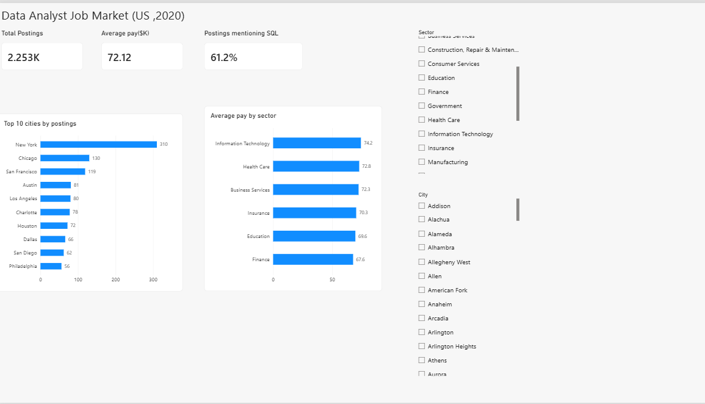

# Data Analyst Job Market Analysis (US, 2020)

I analysed 2,253 Glassdoor "Data Analyst" job postings with SQL and Excel to see which skills, cities, sectors and seniority levels show up most, and how pay compares.

## Tools
- **SQL** (SQLite, DB Browser): all the analysis queries
- **Excel**: cross-checks with COUNTIF, AVERAGEIF and pivot tables
- The raw data was cleaned with a Python script that was prepared with AI assistance (Claude). I used the cleaned file for my own analysis.

## Files
- `DataAnalyst_clean.xlsx` is the cleaned dataset.
- `postings.db` is the cleaned data as a SQLite database (table `postings`, plus a small `regions` lookup table I added).
- `analysis.sql` holds the 10 project queries.
- `joins.sql` holds my JOIN practice on the data.

## How the data was cleaned
- Replaced `-1` placeholders with blanks.
- Split the company name from the rating attached to it.
- Turned salary text (for example "$37K-$66K") into min, max and midpoint columns.
- Split location into city and state.
- Derived seniority from job titles.
- Flagged 23 skills and topics with keyword matches on the job descriptions (1 = mentioned, 0 = not mentioned).

## SQL concepts used
SELECT, WHERE, ORDER BY, LIMIT, COUNT, SUM, AVG, ROUND, GROUP BY, HAVING, percentage calculations, INNER JOIN and LEFT JOIN (with COALESCE).

## What I found
- SQL appears in about 61% of postings, Excel in 40% and Python in 28%.
- About 88% of Python postings also mention SQL.
- Average pay is almost the same with or without SQL in the posting ($71.7K versus $72.8K), so skills don't explain much of the pay in this data.
- Pay varies far more by city than by skill. San Jose, Santa Clara and San Francisco are the highest.
- Senior/Lead titles average about $75K against about $66K for Junior/Entry.
- About 19% of postings mention supply chain or logistics work.

## Limits
- Postings are from 2020 and cover the US only.
- Salaries are Glassdoor estimates, not posted pay, and they fall into a small number of fixed ranges.
- Skills are keyword matches, so a mention does not mean the skill is required.

## Charts

*Pay is the midpoint of the Glassdoor salary estimate, in $K.*

## Key findings

1. **Jobs are concentrated in New York.** New York has 310 postings, more than Chicago and San Francisco combined (249), and 5x San Diego's 62. After New York, the other cities are close together.

2. **Pay barely differs by sector.** Among the six sectors with 50+ postings, average pay ranges only from 67.6K (Finance) to 74.2K (Information Technology), a gap of about 6.6K or 10%. These are Glassdoor estimate ranges, so small differences should not be over-read.

3. **SQL is the most requested skill.** SQL appears in 61.2% of postings, ahead of Excel (40.1%) and Python (28.1%).

## Power BI dashboard

A one-page dashboard built from the cleaned data (`Dataanalyst_Dashboard.pbix`, open it in Power BI Desktop).

- **Cards:** total postings (2,253), average pay ($72.1K) and the share of postings that mention SQL (61.2%).
- **Charts:** top 10 cities by number of postings, and average pay for the six sectors with 50+ postings.
- **Slicers:** filter the whole page by sector or city.

The numbers match my SQL and Excel results.
